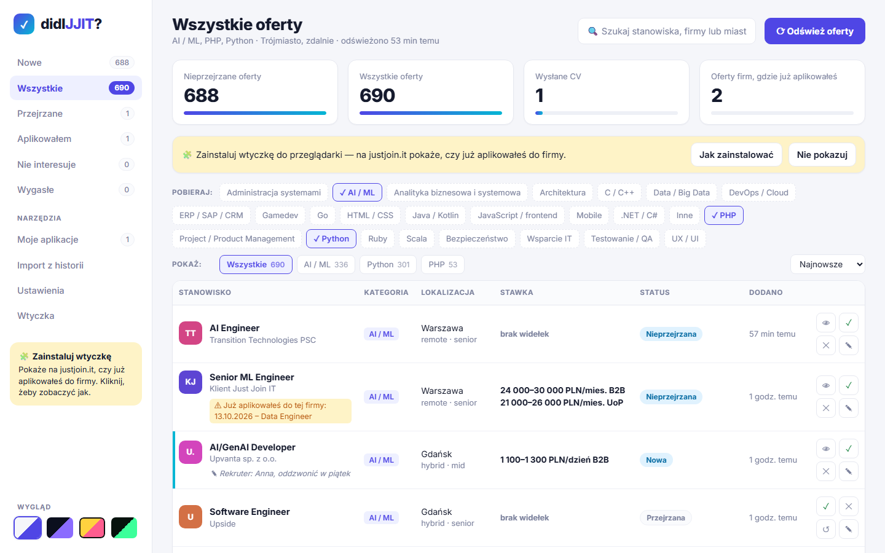
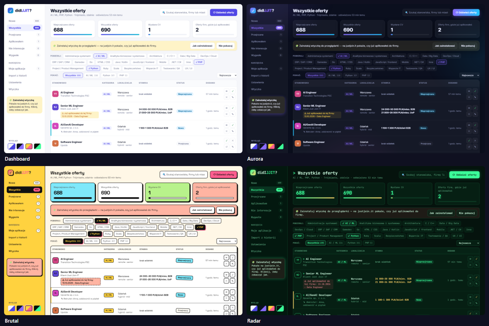
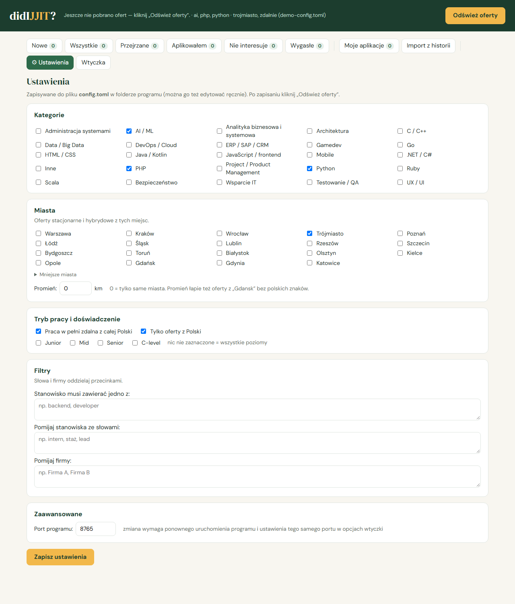

# didIJJIT — *Did I Just Join IT?*

> Czy ja już tu aplikowałem? Teraz będziesz wiedzieć.

Prosty, lokalny program dla osób szukających pracy w IT:

- zbiera oferty z **justjoin.it** według Twoich ustawień (technologie, miasta, praca zdalna);
- wyraźnie pokazuje **nowe** oferty od ostatniego sprawdzenia;
- pamięta, **gdzie już wysłałeś CV**, i ostrzega, gdy trafisz na kolejną ofertę tej samej firmy;
- jednorazowo **odtwarza historię aplikacji** z historii Twojej przeglądarki (Brave, Chrome, Edge, Opera, Vivaldi, Firefox);
- ma **wtyczkę do przeglądarki**, która na stronie oferty justjoin.it pokazuje pasek „już aplikowałeś do tej firmy” i po kliknięciu „Aplikuj” pyta, czy zapisać aplikację.

Wszystko działa na Twoim komputerze. Nie ma kont, chmury, AI ani kluczy API.
Program łączy się tylko z justjoin.it, żeby pobrać listę ofert.



Do wyboru są **4 motywy wyglądu**: Dashboard (jasny), Aurora (ciemny), Brutal (kolorowy) i Radar (terminal).
Przełączasz je kafelkami w lewym dolnym rogu albo w Ustawieniach. Wybór jest zapamiętywany w przeglądarce.



> didIJJIT to nieoficjalne, fanowskie narzędzie do własnego użytku. **Nie jest produktem justjoin.it** ani nie jest z nim w żaden sposób powiązany; nazwa to tylko gra słów.
> Korzysta z tego samego publicznego API listy ofert co strona justjoin.it, więc może przestać działać po zmianach po ich stronie.
> Oferty pobiera tylko po kliknięciu „Odśwież oferty” — nie odpytuje serwisu w tle.

---

## 1. Instalacja

Potrzebny jest **Python 3.10 lub nowszy** ([python.org/downloads](https://www.python.org/downloads/)).
W Windows przy instalacji zaznacz „Add python.exe to PATH”.

Pobierz program: zielony przycisk **Code → Download ZIP** na tej stronie (albo `git clone`) i rozpakuj w wybranym miejscu.

### Windows

Kliknij dwukrotnie **`run.bat`**. Za pierwszym razem program sam zainstaluje potrzebne biblioteki (około minuty).

### macOS / Linux / WSL

```bash
./run.sh
```

Po starcie otwórz **http://localhost:8765** (program zwykle sam otworzy przeglądarkę).
Zatrzymanie: zamknij okno albo naciśnij `Ctrl+C`.

## 2. Ustawienia — jakie oferty Cię interesują

Najprościej w programie: menu **Ustawienia** (albo adres `http://localhost:8765/#ustawienia`).
Zaznaczasz kategorie, miasta, promień, pracę zdalną, poziom doświadczenia i filtry, klikasz **Zapisz**, a potem **Odśwież oferty**.



Wszystko trafia do pliku **`config.toml`**, który można też edytować ręcznie. Przy pierwszym uruchomieniu powstaje on jako kopia `config.example.toml`. Otwórz go w Notatniku lub innym edytorze.
Są w nim **wszystkie kategorie justjoin.it i wszystkie miasta**. Nic nie trzeba szukać, wystarczy włączyć lub wyłączyć `#` na początku linii:

```toml
categories = [
  # "admin",              # Administracja systemami
  "ai",                   # AI / ML          ← włączone
  # "java",               # Java / Kotlin    ← wyłączone
  "python",               # Python
  ...
]

cities = [
  # "warszawa",           # Warszawa
  "trojmiasto",           # Trójmiasto (aglomeracja)
  ...
]

radius_km = 20            # także oferty w promieniu 20 km od wybranych miast
remote = true             # plus praca w pełni zdalna z całej Polski
only_poland = true        # bez ofert zagranicznych
```

Do tego poziom doświadczenia (`junior`, `mid`, `senior`, `c_level`) oraz filtry: słowa wymagane w stanowisku,
słowa wykluczające (np. `"intern"`) i firmy do ukrycia. Każde ustawienie ma w pliku opis i przykład.

**Promień (`radius_km`)**: justjoin.it nie umie szukać „w promieniu”, więc liczy go didIJJIT na podstawie współrzędnych ofert.
Przy promieniu większym niż 0 odświeżanie pobiera oferty z całej Polski, przez co trwa kilka sekund dłużej.
Dodatkowy plus: promień łapie oferty z nazwą miasta wpisaną bez polskich znaków (np. „Gdansk”), które zwykłe wyszukiwanie po mieście pomija.

Literówka w nazwie kategorii lub miasta nie przejdzie po cichu: przy odświeżaniu program pokaże, czego nie zna, i poda poprawne nazwy.

Po zmianie ustawień uruchom program ponownie i kliknij **Odśwież oferty**.
Oferty, które przestały pasować, znikną, chyba że nadałeś im status albo dodałeś notatkę.

## 3. Codzienne używanie

| Widok | Co pokazuje |
|---|---|
| **Nowe** | oferty, których jeszcze nie oceniłeś; te z ostatniego odświeżenia mają żółty pasek |
| **Wszystkie** | wszystkie aktualne oferty |
| **Przejrzane / Aplikowałem / Nie interesuje** | oferty według Twoich statusów |
| **Wygasłe** | oferty, które zniknęły z justjoin.it, ale miały status lub notatkę |
| **Moje aplikacje** | wszystkie miejsca, do których wysłałeś CV, także spoza justjoin.it (można dopisać ręcznie) |
| **Import z historii** | propozycje aplikacji odczytane z historii przeglądarek |

Nad listą są dwa rzędy guzików:

- **Pobieraj** — wszystkie kategorie justjoin.it; włączone są podświetlone z ✓. Kliknięcie włącza lub wyłącza kategorię
  i od razu pobiera oferty, bez wchodzenia w Ustawienia.
- **Pokaż** — filtr listy po kategorii z liczbą ofert (np. „Python 301”), obok **sortowanie**: najnowsze, wg kategorii, firmy albo miasta.
Przy każdej ofercie możesz zmienić status i dopisać notatkę.
Gdy oznaczysz „Aplikowałem”, program zapyta o datę. Od tej chwili każda oferta tej firmy pokaże ostrzeżenie
„Już aplikowałeś do tej firmy” (nazwy porównywane są bez „sp. z o.o.”, „S.A.”, „Polska” itp.).

### Import z historii przeglądarek

Zakładka **Import z historii** szuka w historii (z ostatniego roku):

- stron „dziękujemy za aplikację” po formularzach (eRecruiter, Traffit, pracuj.pl, Lever, Greenhouse i inne) — te są od razu zaznaczone;
- otwartych formularzy aplikacyjnych bez potwierdzenia;
- obejrzanych ofert z ostatnich 60 dni (na wypadek aplikacji przez formularz na samym justjoin.it).

Program czyta **kopię** pliku historii i niczego w przeglądarce nie zmienia. Nic nie trafia do bazy bez Twojego zaznaczenia.
Sprawdź i popraw nazwy firm, potem kliknij **Zapisz**. Pozycje niezaznaczone już się nie pojawią.

Jeśli Twojej przeglądarki nie ma na liście, dopisz jej katalog danych w `config.toml` → `[history] extra_paths`.

## 4. Wtyczka do przeglądarki

Wtyczka jest w folderze **`extension/`**. Działa tylko wtedy, gdy program didIJJIT jest uruchomiony.

Zakładka **Wtyczka** w programie pokazuje, czy wtyczka jest już zainstalowana w przeglądarce (✓), podaje gotową ścieżkę
do folderu z przyciskiem „Kopiuj” i pozwala pobrać wtyczkę jako ZIP — instrukcja poniżej jest tam krok po kroku.

**Brave, Chrome, Edge, Opera, Vivaldi** (wszystkie oparte na Chromium):

1. Wejdź na stronę rozszerzeń: `brave://extensions`, `chrome://extensions`, `edge://extensions`, `opera://extensions` lub `vivaldi://extensions`.
2. Włącz **Tryb dewelopera** (Developer mode).
3. Kliknij **Załaduj rozpakowane** (Load unpacked) i wskaż folder `extension`.

**Firefox** (wersja 121 lub nowsza):

1. Wejdź na `about:debugging#/runtime/this-firefox`.
2. Kliknij **Załaduj tymczasowy dodatek** i wskaż plik `extension/manifest.json`.
3. W `about:addons` → didIJJIT → **Uprawnienia** zezwól na dostęp do justjoin.it i localhost.

Firefox usuwa tymczasowe dodatki po zamknięciu przeglądarki. Żeby wtyczka zostawała na stałe, trzeba ją podpisać
(bezpłatnie, jako dodatek „unlisted” na addons.mozilla.org).

**Co robi wtyczka na stronie oferty justjoin.it:**

- zielony pasek — już aplikowałeś na tę ofertę;
- żółty pasek — aplikowałeś do tej firmy na inne stanowisko (z datami);
- po kliknięciu **Aplikuj / Apply** pyta: „Wysłałeś CV?”. „Tak, zapisz” dodaje aplikację do programu.

Jeśli zmienisz port w `config.toml`, ustaw ten sam port w opcjach wtyczki.

## 5. Twoje dane

- Baza: `data/didijjit.db` (SQLite) w folderze programu. Kopia zapasowa = skopiowanie tego pliku.
- `config.toml` i `data/` nie trafiają do gita, więc aktualizacja programu ich nie nadpisze.
- Serwer nasłuchuje tylko na `127.0.0.1`, więc inne komputery w sieci go nie widzą.

## 6. Aktualizacja

Pobierz nową wersję i podmień pliki programu, zostawiając `data/` i `config.toml`.
Przy `git clone` wystarczy `git pull`. Wtyczkę przeładuj na stronie rozszerzeń.

## Dla programistów

```bash
./run.sh                                          # tworzy .venv i uruchamia program
.venv/bin/python -m pip install -r requirements-dev.txt
.venv/bin/python -m pytest -q                     # testy
```

Budowa: FastAPI + SQLite + jedna strona HTML bez frameworka (`didijjit/static/index.html`); wtyczka w Manifest V3,
wspólna dla Chromium i Firefoksa. Zmienne środowiskowe: `DIDIJJIT_DB`, `DIDIJJIT_CONFIG`.

Zgłoszenia błędów i propozycje — przez Issues.

⭐ **Jeśli program Ci pomógł, zostaw gwiazdkę na GitHubie** — dzięki temu łatwiej trafi do innych szukających pracy.

## Licencja

MIT — zobacz [LICENSE](LICENSE).
